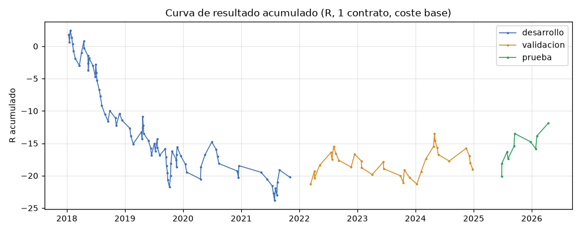
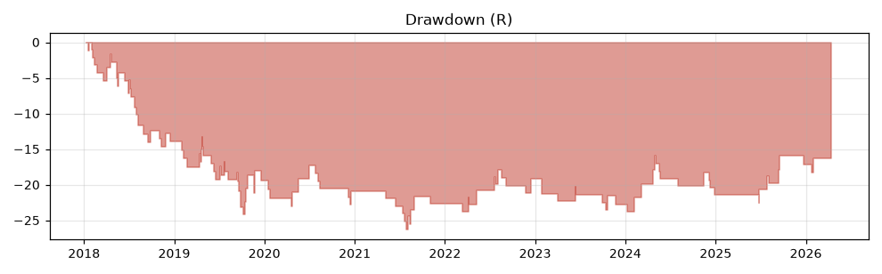
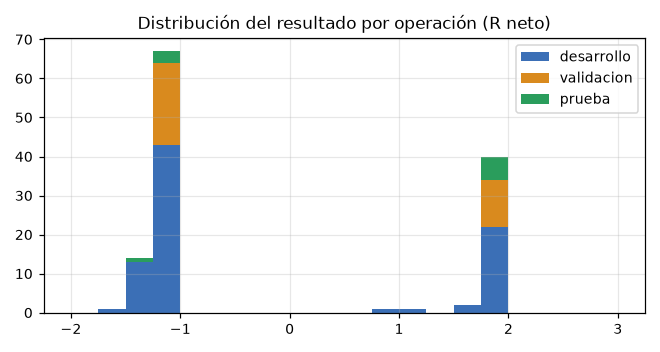
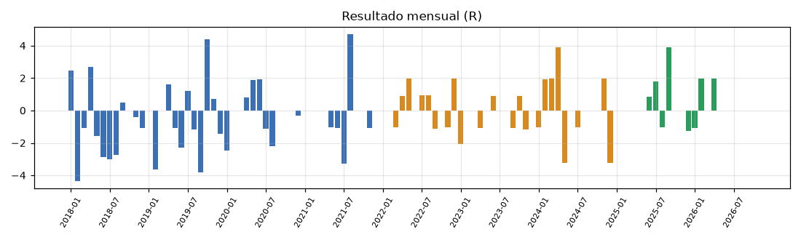
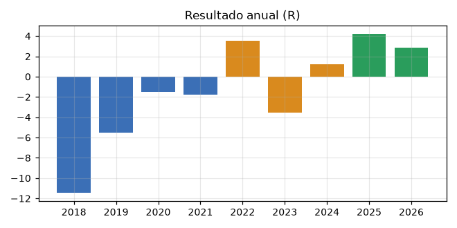
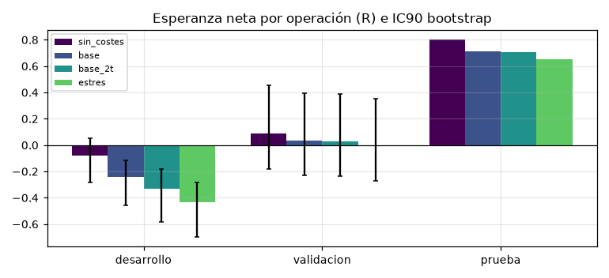
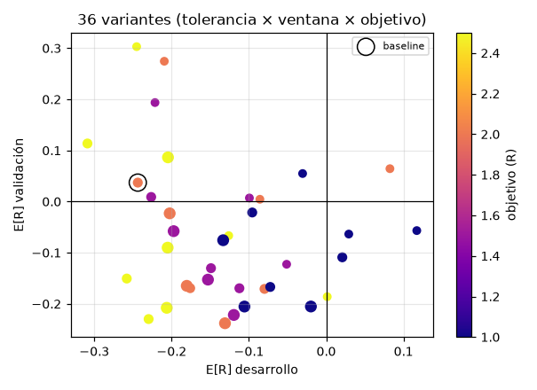

# MNQ_ORB_RETEST_v1.0 · informe técnico
Ejecutado 2026-10-17T06:34:39 · código `1152218` · reglas `51bd2fc16336f433` (congeladas: sí) · prueba abierta: True

## Conclusión

**Veredicto: esta versión no tiene una ventaja demostrada y no justifica operarla.** Según el protocolo del laboratorio
(`config/PROTOCOLO.yaml`) queda **INCONCLUSA**:
- positiva fuera de muestra, pero el IC90 incluye 0;
- 43 operaciones fuera de muestra, por debajo de las 100 que exige el protocolo.

En la práctica se descarta: el periodo con más operaciones (desarrollo) es claramente negativo, y la robustez es mala.

| Pregunta | Respuesta con los datos (coste base, 1 contrato) |
|---|---|
| 1 · ¿Esperanza positiva tras costes? | **No demostrada.** Desarrollo −0,244 R (IC90 −0,46 a −0,11, entero bajo 0). Validación +0,037 R (IC90 −0,23 a +0,40). Prueba +0,711 R, pero con solo 10 operaciones. Fuera de muestra +0,194 R (IC90 −0,22 a +0,34). |
| 2 · ¿Rendimiento con 2R? | Acierto 31 % / 36 % / 60 % y PF 0,69 / 1,06 / 4,88 (desarrollo / validación / prueba). Total 2018-2026: −11,9 R en 126 operaciones. |
| 3 · ¿Drawdown y su duración? | Desarrollo −26,3 R, sin recuperarse en 971 sesiones. Fuera de muestra −6,6 R, 415 sesiones. Racha perdedora máxima: 7. |
| 4 · ¿% que llega al TP antes que al SL? | 29 % en desarrollo, 36 % en validación, 60 % en prueba. Con 2R hace falta ~35 % solo para cubrir costes. |
| 5 · ¿Cuándo funciona o falla? | Sin un patrón estable. Los largos pierden en desarrollo y en validación (−0,38 / −0,39 R); los cortos solo ganan en validación. Los terciles de anchura del rango y de volatilidad cambian de signo entre periodos: es ruido con 30 operaciones por grupo. |
| 6 · ¿Robusta o depende de parámetros? | **No es robusta.** Solo 1 de 36 combinaciones (tolerancia × ventana × objetivo) es positiva en desarrollo y validación. La hora límite tampoco ayuda. |
| 7 · ¿Riesgo compatible con el drawdown? | Con esperanza ≈ 0, ningún riesgo es rentable en expectativa. Si la operas igualmente, con 100 $ por operación hay un 9 % de probabilidad de tocar −1.000 $ en un año. Ojo: con 25-50 $ no cabe ni un contrato en muchas operaciones (19 de 33 en validación con 50 $), porque el stop mediano ya es de 18-28 pts (37-57 $ por contrato). |
| 8 · ¿Cuántas oportunidades? | 1,7 al mes en 2018-2021; 0,9 en 2022-2024; **0,45 en 2025-2026** (una cada dos meses). |
| 9 · ¿Sobrevive a más costes? | Desarrollo es negativo incluso sin costes (−0,08 R). Validación pasa de +0,04 a −0,01 R con costes de estrés. |

### Por qué casi no hay operaciones
La tolerancia del retesteo es fija en puntos (±2 ticks = 0,5 pts), pero la volatilidad del Nasdaq en puntos se ha
multiplicado por ~3 entre 2018 y 2026. Que el mínimo de una vela de 5 min caiga justo en esa franja de 1 punto es cada
vez más raro: 30 operaciones en 2018 y solo 3 en 2026 (hasta octubre). La regla no es estable en el tiempo. Ampliar la
tolerancia a 4 ticks da más operaciones, pero sigue negativa en desarrollo y en validación.

### Recomendación
1. **Descartar MNQ_ORB_RETEST_v1 para operar** con dinero, ni en Topstep ni en Apex.
2. **Seguir en simulación no resuelve nada**: con ~0,5 operaciones al mes, las 60 operaciones que pide el protocolo para
   un forward test tardarían unos 10 años.
3. Si quieres seguir investigando el ORB con retesteo, la única hipótesis razonable es una **versión nueva** con la
   tolerancia proporcional a la volatilidad (por ejemplo, un % del rango de apertura). Sería una hipótesis nueva:
   toda la historia 2018-2026 ya está vista, así que solo se podría validar con datos futuros.

### Limitaciones
- **Datos de 1 min:** el orden dentro del minuto se aproxima de forma conservadora (SL primero). Solo 1 operación fue
  ambigua y ninguna tuvo hueco en el stop.
- **Muestra pequeña:** 126 operaciones en total y 43 fuera de muestra. Ningún intervalo de confianza excluye un
  resultado nulo fuera de muestra.
- **Precio de NQ como MNQ:** MNQ empezó en may-2019; la liquidez y el deslizamiento reales de MNQ no se han medido.
- **Costes:** las comisiones son valores de trabajo, no las de tu cuenta.
- **Datos:** desde 2018 (no desde 2015, como pedía el encargo). El proyecto local del encargo (`src/engine/...`,
  `config/particion.json`, 49 tests) no existe en este entorno: se reutilizó la infraestructura equivalente del
  laboratorio.
- **Pruebas previas:** este laboratorio ya probó otras versiones del ORB con los mismos datos (p. ej.
  `run_orb_retest_video.py`), así que ningún periodo es una prueba totalmente virgen para la familia ORB.

## Métricas por partición (coste base: 1 USD/lado + 1 tick por ejecución a mercado o stop)
| Métrica | desarrollo | validacion | prueba | total_fuera_de_muestra |
|---|---|---|---|---|
| Sesiones | 992 | 741 | 432 | 1173 |
| Operaciones | 83 | 33 | 10 | 43 |
| Ops/mes | 1.729 | 0.917 | 0.455 | 0.741 |
| Acierto | 0.313 | 0.364 | 0.600 | 0.419 |
| E[R] neta | -0.244 | 0.037 | 0.711 | 0.194 |
| IC90 E[R] | [-0.46, -0.11] | [-0.23, +0.40] | [—, —] | [-0.22, +0.34] |
| E[R] bruta | -0.104 | 0.083 | 0.790 | 0.247 |
| Profit factor | 0.692 | 1.065 | 4.876 | 1.406 |
| E[$] 1 contrato | -5.343 | 2.561 | 50.00 | 13.59 |
| Ganancia/pérdida media | 1.516 | 1.863 | 3.251 | 1.953 |
| Máx. DD (R) | -26.31 | -5.821 | -2.356 | -6.592 |
| Duración máx. DD (sesiones) | 971 | 415 | 74 | 415 |
| Racha perdedora máx. | 7 | 4 | 2 | 4 |
| Peor mes (R) | -4.361 | -3.237 | -1.263 | -3.237 |
| Meses positivos | 0.234 | 0.324 | 0.455 | 0.320 |
| Stop mediano (pts) | 9.000 | 27.75 | 18.38 | 25.00 |
| Minutos medios en posición | 24.28 | 24.76 | 34.80 | 27.09 |
| Ambiguas SL/TP | 1 | 0 | 0 | 0 |
| Stops con hueco | 0 | 0 | 0 | 0 |
| Autocorrelación R (1) | 0.016 | -0.065 | -0.140 | -0.029 |

## Sensibilidad a costes (E[R] neta por partición)
| Escenario | desarrollo | validacion | prueba | total_fuera_de_muestra |
|---|---|---|---|---|
| sin_costes | -0.079 (PF 0.81) | +0.091 (PF 1.13) | +0.800 (PF 5.43) | +0.256 (PF 1.50) |
| base | -0.244 (PF 0.69) | +0.037 (PF 1.06) | +0.711 (PF 4.88) | +0.194 (PF 1.41) |
| base_2t | -0.334 (PF 0.62) | +0.030 (PF 1.06) | +0.705 (PF 4.77) | +0.187 (PF 1.39) |
| proyecto_previo | -0.301 (PF 0.64) | +0.042 (PF 1.07) | +0.724 (PF 4.87) | +0.200 (PF 1.41) |
| estres | -0.436 (PF 0.56) | -0.006 (PF 1.02) | +0.652 (PF 4.44) | +0.147 (PF 1.34) |

## Tamaño por riesgo (USD; cada partición empieza de cero)
| Riesgo/op. | Partición | Neto USD | Contratos medios | Ops. sin contrato |
|---|---|---|---|---|
| 25 $ | desarrollo | -184 | 1.44 | 28 |
| 25 $ | validacion | -55 | 1.00 | 30 |
| 25 $ | prueba | -5 | 1.50 | 8 |
| 50 $ | desarrollo | -622 | 2.52 | 4 |
| 50 $ | validacion | +25 | 1.29 | 19 |
| 50 $ | prueba | +178 | 1.71 | 3 |
| 100 $ | desarrollo | -1406 | 5.34 | 1 |
| 100 $ | validacion | +248 | 1.89 | 5 |
| 100 $ | prueba | +382 | 3.22 | 1 |

## Riesgo de ruina (Monte Carlo por bloques de 10 operaciones, 15 operaciones = 1 año)
Hipótesis: todas las operaciones 2018-2026 (coste base) representan el futuro; riesgo fijo por R; drawdown medido sobre el saldo tras cada operación. Con una esperanza ≈ 0 el resultado depende sobre todo de la varianza.

| Riesgo/op. | Límite de DD | P(alcanzar el límite en 1 año) | DD al 95 % en 1 año |
|---|---|---|---|
| 25 $ | 1000 $ | 0.0% | 272 $ |
| 25 $ | 2000 $ | 0.0% | 272 $ |
| 50 $ | 1000 $ | 0.0% | 544 $ |
| 50 $ | 2000 $ | 0.0% | 544 $ |
| 100 $ | 1000 $ | 8.8% | 1088 $ |
| 100 $ | 2000 $ | 0.0% | 1088 $ |

## Robustez

Variantes evaluadas: 48 (rejilla completa de 36). Positivas en desarrollo Y validación (coste base): **1 de 36**. Detalle en `robustness.csv`.

| variante | tol_ticks | ventana | tp_r | hora_limite | coste | desarrollo_ops | desarrollo_ER | validacion_ops | validacion_ER | prueba_ops | prueba_ER |
|---|---|---|---|---|---|---|---|---|---|---|---|
| BASELINE | 2 | 3 | 2 | 11:30 | base | 83 | -0.244 | 33 | +0.037 | 10 | +0.711 |
| hora_limite | 2 | 3 | 2 | 11:00 | base | 81 | -0.259 | 31 | +0.012 | 10 | +0.711 |
| hora_limite | 2 | 3 | 2 | 10:30 | base | 69 | -0.180 | 26 | -0.010 | 8 | +0.783 |
| hora_limite | 2 | 3 | 2 | 12:30 | base | 86 | -0.221 | 34 | +0.003 | 10 | +0.711 |
| coste | 2 | 3 | 2 | 11:30 | sin_costes | 83 | -0.079 | 33 | +0.091 | 10 | +0.800 |
| coste | 2 | 3 | 2 | 11:30 | base | 83 | -0.244 | 33 | +0.037 | 10 | +0.711 |
| coste | 2 | 3 | 2 | 11:30 | base_2t | 83 | -0.334 | 33 | +0.030 | 10 | +0.705 |
| coste | 2 | 3 | 2 | 11:30 | proyecto_previo | 83 | -0.301 | 33 | +0.042 | 10 | +0.724 |
| coste | 2 | 3 | 2 | 11:30 | estres | 83 | -0.436 | 33 | -0.006 | 10 | +0.652 |
| tp_al_tocar | 2 | 3 | 2 | 11:30 | base_tp_toque | 83 | -0.244 | 33 | +0.037 | 10 | +0.711 |
| secundario_anchura_OR_pct | 2 | 3 | 2 | 11:30 | base | 28 | -0.015 | 9 | -0.753 | 8 | +0.778 |
| secundario_anchura_OR_pct | 2 | 3 | 2 | 11:30 | base | 27 | -0.119 | 9 | +0.624 | 1 | -1.093 |
| secundario_anchura_OR_pct | 2 | 3 | 2 | 11:30 | base | 28 | -0.593 | 15 | +0.159 | 1 | +1.985 |

### Desglose por año

| Partición | año | Ops | Acierto | E[R] | R total |
|---|---|---|---|---|---|
| desarrollo | 2018 | 30 | 0.27 | -0.382 | -11.5 |
| desarrollo | 2019 | 31 | 0.35 | -0.177 | -5.5 |
| desarrollo | 2020 | 12 | 0.33 | -0.125 | -1.5 |
| desarrollo | 2021 | 10 | 0.30 | -0.178 | -1.8 |
| prueba | 2025 | 7 | 0.57 | +0.608 | +4.3 |
| prueba | 2026 | 3 | 0.67 | +0.953 | +2.9 |
| validacion | 2022 | 11 | 0.45 | +0.322 | +3.5 |
| validacion | 2023 | 9 | 0.22 | -0.397 | -3.6 |
| validacion | 2024 | 13 | 0.38 | +0.097 | +1.3 |

### Desglose por lado

| Partición | lado | Ops | Acierto | E[R] | R total |
|---|---|---|---|---|---|
| desarrollo | corto | 36 | 0.36 | -0.065 | -2.3 |
| desarrollo | largo | 47 | 0.28 | -0.380 | -17.9 |
| prueba | corto | 1 | 1.00 | +1.810 | +1.8 |
| prueba | largo | 9 | 0.56 | +0.589 | +5.3 |
| validacion | corto | 15 | 0.53 | +0.554 | +8.3 |
| validacion | largo | 18 | 0.22 | -0.393 | -7.1 |

### Desglose por or_width_pct_tercil

| Partición | or_width_pct_tercil | Ops | Acierto | E[R] | R total |
|---|---|---|---|---|---|
| desarrollo | alto | 28 | 0.18 | -0.593 | -16.6 |
| desarrollo | bajo | 28 | 0.39 | -0.015 | -0.4 |
| desarrollo | medio | 27 | 0.37 | -0.119 | -3.2 |
| prueba | alto | 1 | 1.00 | +1.985 | +2.0 |
| prueba | bajo | 8 | 0.62 | +0.778 | +6.2 |
| prueba | medio | 1 | 0.00 | -1.093 | -1.1 |
| validacion | alto | 15 | 0.40 | +0.159 | +2.4 |
| validacion | bajo | 9 | 0.11 | -0.753 | -6.8 |
| validacion | medio | 9 | 0.56 | +0.624 | +5.6 |

### Desglose por vol20_prev_tercil

| Partición | vol20_prev_tercil | Ops | Acierto | E[R] | R total |
|---|---|---|---|---|---|
| desarrollo | alto | 27 | 0.33 | -0.153 | -4.1 |
| desarrollo | bajo | 27 | 0.33 | -0.204 | -5.5 |
| desarrollo | medio | 26 | 0.23 | -0.502 | -13.1 |
| desarrollo | sin_dato | 3 | 0.67 | +0.827 | +2.5 |
| prueba | alto | 1 | 1.00 | +1.969 | +2.0 |
| prueba | bajo | 5 | 0.60 | +0.712 | +3.6 |
| prueba | medio | 4 | 0.50 | +0.396 | +1.6 |
| validacion | alto | 22 | 0.41 | +0.185 | +4.1 |
| validacion | bajo | 4 | 0.25 | -0.297 | -1.2 |
| validacion | medio | 7 | 0.29 | -0.236 | -1.7 |

### Desglose por roll_week

| Partición | roll_week | Ops | Acierto | E[R] | R total |
|---|---|---|---|---|---|
| desarrollo | False | 74 | 0.34 | -0.171 | -12.6 |
| desarrollo | True | 9 | 0.11 | -0.843 | -7.6 |
| prueba | False | 9 | 0.56 | +0.573 | +5.2 |
| prueba | True | 1 | 1.00 | +1.952 | +2.0 |
| validacion | False | 29 | 0.34 | -0.021 | -0.6 |
| validacion | True | 4 | 0.50 | +0.460 | +1.8 |

## Gráficos

